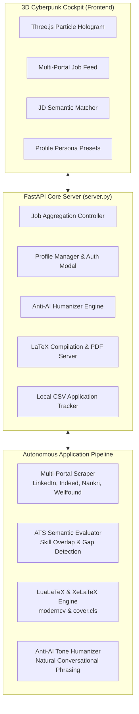

# ApplyBot ⚡
### Autonomous Multi-Portal Job Hunter & AI Career Copilot

<p align="center">
  
  
  
  
  
  
  
</p>

<p align="center">
  <a href="https://render.com/deploy?repo=https://github.com/twinkleghangare/ApplyBot" target="_blank">
    
  </a>
</p>

---

## 🌟 What is ApplyBot?

**ApplyBot** is a high-performance, local-first **Career Operating System & Autonomous Job Application Copilot**. It combines a futuristic **3D cyberpunk glassmorphic cockpit** with an autonomous multi-agent pipeline designed to eliminate the friction, rejection traps, and tedious manual labor of the modern job search.

Unlike traditional bots that spam generic resumes or crash on dynamic forms, ApplyBot introduces an **Anti-AI Detection Humanizer**, **Multi-Portal Resilient Aggregation**, and **LuaLaTeX ATS-Compliant PDF Compilation** with real-time text-layer verification.

---

## 🎯 Core Problems Solved

| Problem in Market | The Legacy Bottleneck | How ApplyBot Solves It |
| :--- | :--- | :--- |
| **The "Anti-AI" Detection Trap** | 65%+ of modern HRs use AI scanners that instantly reject resumes filled with ChatGPT buzzwords (*"orchestrated"*, *"meticulous"*, *"spearheaded"*). | **Anti-AI Humanizer Engine:** Rewrites resumes and cover letters in a natural, authentic, human conversational tone that effortlessly bypasses recruiter AI detection algorithms. |
| **Brittle Auto-Apply Bots** | Legacy headless browser bots (Selenium/Playwright) crash when encountering dynamic UI changes on Workday, Taleo, Greenhouse, or LinkedIn. | **Resilient Multi-Portal Engine:** Dual-mode architecture combining visual screen parsing and clean REST/DOM ingestion across LinkedIn, Indeed, Glassdoor, Naukri, Wellfound, RemoteOK, and corporate career portals. |
| **Contextual Fraud & Blind Spamming** | Blind mass-applying leads to low conversion rates, candidate burnout, and blacklisting for applying to unfit roles. | **Semantic Skill-Gap Analysis:** Computes real semantic vector overlap against job requirements. Highlights genuine strengths and acknowledges honest gaps rather than artificial keyword stuffing. |
| **Complex Custom Portal Questions** | Portals ask tricky behavioral questions (*"Describe a challenge with an uncooperative stakeholder"*), leading to generic AI responses. | **Fact-Grounded Custom Answers:** Generates high-impact STAR-format answers extracted strictly from verified past experience without hallucinations. |

---

## 🚀 Key Features

### 🖥️ 1. Interactive 3D Cyberpunk Cockpit UI
- **Three.js Particle Grid & Hologram Visualizer:** Interactive 3D starfield canvas rendering real-time application telemetry.
- **Dynamic Multi-Portal Feed:** Live listings aggregated across LinkedIn, Indeed, Glassdoor, Naukri, Wellfound, RemoteOK, Workday, and Lever.
- **Instant Job Description Filter:** Paste any JD to immediately score matching percentage, missing tech stacks, and core alignment.
- **Multi-Persona Switcher:** Switch between technical presets (*AI & ML Engineer*, *Full-Stack AI Developer*, *Custom Blank Profile*) with credential presets.

### 📄 2. LuaLaTeX ATS-Compliant Resume Engine
- **Pixel-Perfect Compilation:** Uses LuaLaTeX and XeLaTeX with `moderncv` (banking style) and custom `cover.cls` typography.
- **Text-Layer ATS Verification:** Validates extracted PDF text using `pypdf` / `pdftotext` to ensure applicant tracking systems (Workday, Greenhouse, Taleo) read exact contact information and skills without garbled glyphs.
- **Single-Page / Two-Page Enforcement:** Automatically tightens vertical spacing, eliminates orphaned headings, and keeps resumes neatly bounded.

### 🛡️ 3. Anti-AI Humanized Drafting
- Filters out robotic cliches, buzzword spam, and standardized ChatGPT sentence structures.
- Generates forward-looking cover letters tailored to the target company's mission and technical stack.
- Maintains 100% honesty: never fabricates non-existent years of experience or false credentials.

### 🔒 4. Local-First & 100% Private
- **Zero Cloud Leakage:** All candidate profile data, documents, LaTeX source files, and tracking spreadsheets remain stored strictly on your local machine.
- **No Mandatory Paid Subscriptions:** Works out of the box locally via FastAPI and standard CLI workflows.

---

## 🏗️ Architecture Overview



---

## ⚡ Quick Start Guide

### Prerequisites
- **Python 3.10+**
- **LaTeX Distribution** with `lualatex` & `xelatex`:
  - Windows: [MiKTeX](https://miktex.org/) or [TeX Live](https://tug.org/texlive/)
  - Linux: `sudo apt install texlive-latex-extra texlive-xetex texlive-luatex`
  - macOS: [MacTeX](https://tug.org/mactex/) or `brew install --cask mactex-no-gui`
- *(Optional)* [Bun](https://bun.sh) for standalone job scraper CLI modules.

---

### Installation

1. **Clone the Repository:**
   ```bash
   git clone https://github.com/twinkleghangare/ApplyBot.git
   cd ApplyBot
   ```

2. **Create a Virtual Environment & Install Dependencies:**
   ```bash
   # Windows (PowerShell)
   python -m venv .venv
   .\.venv\Scripts\activate
   pip install -r requirements.txt

   # Linux / macOS
   python3 -m venv .venv
   source .venv/bin/activate
   pip install -r requirements.txt
   ```

3. **Launch the Application:**

   **Windows One-Click Launch:**
   Double-click `run_app.bat`

   **Or via Command Line:**
   ```bash
   uvicorn server:app --host 127.0.0.1 --port 8000 --reload
   ```

4. **Open in Browser:**
   Navigate to [http://localhost:8000](http://localhost:8000) to access the 3D Cockpit.

---

### ☁️ Cloud Deployment (Render)

Deploy ApplyBot to the cloud on **Render** in 1 click:

1. Click the **[Deploy to Render](https://render.com/deploy?repo=https://github.com/twinkleghangare/ApplyBot)** button above or create a **New Web Service** on [dashboard.render.com](https://dashboard.render.com).
2. Connect your GitHub repository `https://github.com/twinkleghangare/ApplyBot`.
3. Set the following settings:
   - **Environment:** `Python`
   - **Build Command:** `pip install -r requirements.txt`
   - **Start Command:** `uvicorn server:app --host 0.0.0.0 --port $PORT`
   - **Plan:** `Free`
4. Click **Create Web Service** — your live 3D Cockpit URL will be ready at `https://applybot-xxxx.onrender.com`!

---

## 💻 CLI & Autonomous Agent Workflow

ApplyBot can also be operated as an autonomous CLI agent with **Claude Code**, **Antigravity**, or directly in your terminal:

```
/setup           /scrape              /apply <url>
  │                │                     │
  ▼                ▼                     ▼
Fill in        Search job           Evaluate fit
your profile   portals              Score & recommend
  │                │                     │
  ▼                ▼                     ▼
Profile        Present matches      Draft CV + Cover Letter
files ready    with fit ratings     (LaTeX, tailored)
                   │                     │
                   ▼                     ▼
               Pick a match         Reviewer agent critiques
               -> /apply            -> Revise -> Final output
```

### Core CLI Commands

| Command | Action | Description |
| :--- | :--- | :--- |
| `/setup` | **Onboard Profile** | Imports existing CV, parses LinkedIn export, or conducts an interactive intake interview. |
| `/scrape` | **Multi-Portal Discovery** | Searches job portals, deduplicates listings, and scores preliminary role fit. |
| `/rank` | **Batch Triage** | Evaluates a batch of scraped jobs and produces an urgency-weighted shortlist. |
| `/apply <url>` | **Tailor & Compile** | Runs full drafter-reviewer cycle: tailors CV, drafts cover letter, compiles PDF, and ATS-checks. |
| `/interview` | **Interview Prep** | Researches company, predicts technical/behavioral questions, and provides STAR mock drills. |
| `/outcome` | **Track & Follow-up** | Records application outcomes, drafts polite follow-ups, and archives submission history. |
| `/upskill` | **Skill Gap Heatmap** | Identifies gaps between your profile and target roles, producing curated study roadmaps. |

---

## 📁 Project Structure

```
ApplyBot/
├── server.py                          # FastAPI backend & API orchestrator
├── run_app.bat                        # Windows one-click launcher
├── requirements.txt                   # Python package dependencies
├── candidate_profile.json             # Active user profile & credentials
├── job_search_tracker.csv             # Application tracking spreadsheet
├── static/                            # 3D Cyberpunk Cockpit Frontend
│   ├── index.html                     # Cockpit UI, modal systems & telemetry
│   ├── app.js                         # Application state, 3D Canvas & API logic
│   └── style.css                      # Glassmorphism, animations & Tailwind styles
├── cv/                                # LaTeX CV templates
│   ├── main_example.tex               # Reference moderncv template
│   └── main_candidate.pdf             # Compiled ATS-compliant resume
├── cover_letters/                     # Cover letter engine
│   ├── cover.cls                      # Custom LaTeX class
│   └── OpenFonts/                     # Lato & Raleway typography
├── .claude/                           # Agent commands & skill specifications
│   ├── commands/                      # /apply, /scrape, /setup, /interview, /rank
│   └── skills/                        # Profile specs, behavioral guides, ATS rubrics
├── .agents/skills/                    # Modular portal search CLIs (LinkedIn, Freehire, etc.)
├── documents/                         # Local source materials (CVs, diplomas, past records)
└── tools/                             # PDF verification, layout checking, and CI utilities
```

---

## 🛡️ Privacy & Security

- **Local Execution:** Your sensitive personal data (phone, address, employment history, compensation details) never touches third-party SaaS servers.
- **No Secret Scraping:** Search tools run explicitly through local CLI skills that respect rate limits and terms of service.
- **Untrusted Input Isolation:** Job postings pass through a strict integrity gate (`tools/posting_guard.py`) that strips hidden characters, injection prompts, and malicious links before analysis.

---

## 🤝 Contributing

Contributions, feedback, and pull requests are warmly welcomed! Please feel free to open an issue or submit a PR.

1. Fork the Project
2. Create your Feature Branch (`git checkout -b feature/AmazingFeature`)
3. Commit your Changes (`git commit -m 'Add some AmazingFeature'`)
4. Push to the Branch (`git push origin feature/AmazingFeature`)
5. Open a Pull Request

---

## 📄 License

Distributed under the **MIT License**. See `LICENSE` for more information.

---

<p align="center">
  <b>Built with ❤️ by <a href="https://github.com/twinkleghangare">twinkleghangare</a></b><br>
  <i>Empowering job seekers worldwide with intelligent, humanized, and autonomous career tooling.</i>
</p>
